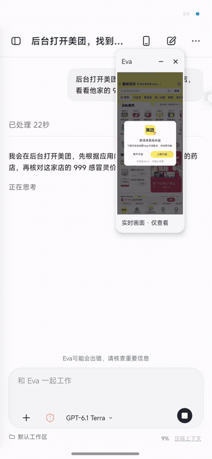
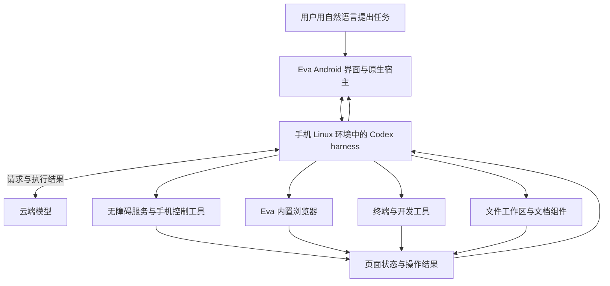
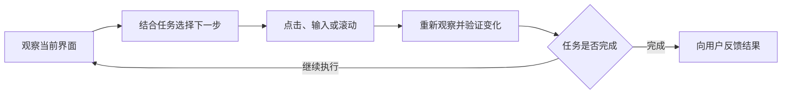
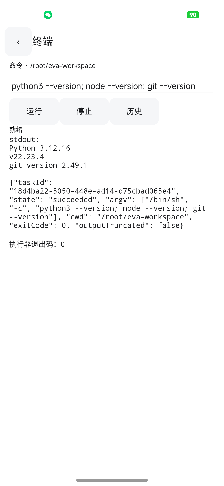
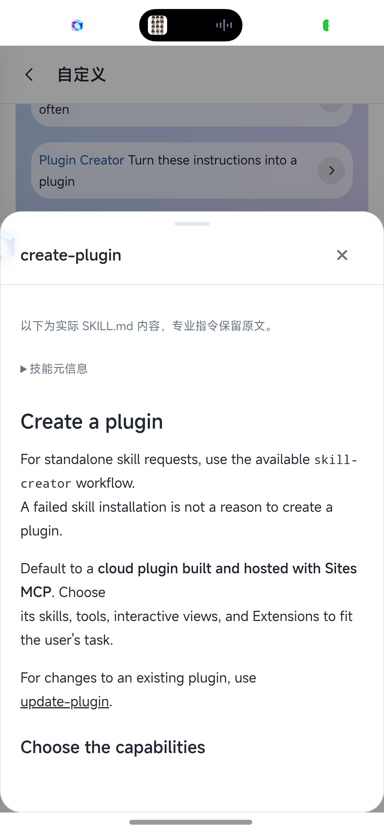

# Eva - codex for phone

Eva - codex for phone 是一个基于开源 Codex harness 开发的 Android 手机 AI 代理项目。项目将 Codex 的代理执行框架移植到手机运行环境，并接入 Android 无障碍服务、Eva 内置浏览器、文件工作区和本地开发工具，让用户通过自然语言安排手机操作、网页任务、文件制作与编程开发。

模型在云端完成推理，代理运行和工具执行由手机承担。用户提出目标后，Eva 通过模型理解需求、安排步骤，调用手机上的工具执行，再根据页面状态、命令输出和文件结果继续处理。项目希望将这条工作流程完整带到手机上，让手机能够承担从操作应用到编写代码、生成文件的实际工作。

当前项目处于公开测试阶段，持续推进设备兼容、复杂 App 操作、浏览器能力迁移和本地工具链完善。

## 手机操作演示

下面的录屏展示用户提出美团药店与商品查找任务后，Eva 在对话中执行手机操作，并通过悬浮预览展示目标 App 的页面变化。

[](docs/media/eva-phone-agent-demo.mp4)

[观看完整演示视频，约 40 秒](docs/media/eva-phone-agent-demo.mp4) · 动图截取原视频第 12–28 秒，完整视频保留原始录屏与声音。

## 基于 Codex harness 的手机端移植

Eva Android 以开源 Codex 的代理执行框架为基础，沿用其会话、任务回合、工具调用和执行事件机制。这里的 harness 指围绕模型运行的代理框架，负责连接模型、维护任务上下文、组织工具执行，并将执行过程反馈给模型和用户。

手机应用的私有 Linux 环境运行 Linux ARM64 版 `codex app-server`。Android 原生宿主连接该进程，适配进程管理、模型配置、凭据、应用生命周期和工具接口。会话通过 `thread/start`、`thread/resume` 创建与恢复，任务通过 `turn/start` 发起，通过 `turn/interrupt` 中断，界面消费内核返回的结构化事件，展示回复、命令输出、工具调用和任务进度。

这套架构将云端模型与手机执行环境连接起来。模型可以结合工具结果继续推理，连续完成多个步骤。手机保存自己的工作区、会话和运行配置，承担本地代理进程与任务执行。

项目同时迁移桌面 Eva 中成熟的信息流、模型管理、文件阅读和浏览器逻辑，并针对触摸交互、Android 权限、存储及后台运行进行适配。Codex 的版本、运行方式和来源核验记录保存在迁移文档中。相关实现见 [内核迁移说明](docs/CODEX_MIGRATION.md) 和 [Android 内核宿主](probe/src/KernelHost.java)。



上图展示任务、模型与手机工具之间的连接关系，代理进程和工具在手机上运行。

## 通过无障碍服务控制手机

Eva 通过 Android 无障碍服务获取当前界面的可访问控件信息，识别按钮、输入框、文本和可滚动区域，并执行点击、输入、滚动、返回与回到主页等操作。对于需要坐标交互的页面，工具层还提供手势操作，并结合截图与界面观察辅助判断。

手机控制采用观察、操作、再次观察的执行流程。代理先读取页面，选择目标控件或操作位置，执行后重新检查界面变化，再决定后续步骤。控件快照发生变化时，需要重新观察页面，以减少使用过期控件造成的误操作。

这套能力用于打开应用、查找入口、填写内容、浏览页面以及串联多个 App 的操作。项目还实现了按应用和版本记录的导航路线与批处理机制，用于复用已经验证的操作步骤，并在页面状态不符时重新观察与恢复。

使用手机代理功能时，请安装并启动 Shizuku，在 Eva 中完成 Shizuku 授权，同时在系统设置中启用 Eva 的无障碍服务。后台虚拟屏和 ADB / Shell 增强能力需要 Shizuku 提供的权限通道。后台虚拟屏与悬浮预览也在持续开发和验证中，其可用性受系统版本、目标应用及设备环境影响。控制实现见 [无障碍服务](probe/src/PhoneAccessibility.java)，路线和资源调度记录见 [0.0.76 验收记录](docs/RELEASE_0_0_76.md)。



## 在手机上编程与开发

Eva 在应用私有目录中维护基于 PRoot 的 Linux 运行环境，为代理提供终端、文件系统和开发工具。模型可以直接在手机工作区读取项目、创建目录、编写源码、修改配置、运行命令，并根据实际输出继续调试。

本地开发覆盖以下工作内容。

- 使用 Python、Node.js 和 Shell 编写脚本，处理文本、数据与批量文件任务。
- 创建和修改 HTML、CSS、JavaScript 等网页文件，并结合预览检查结果。
- 使用 Git 管理源码，查看差异、记录修改和处理项目文件。
- 运行项目所需的命令、检查或测试，根据错误信息修复代码。
- 按任务需求安装开发依赖，检查安装结果后继续执行。
- 使用适配 ARM64 的 Android 工具链编译项目、生成 APK，并查看构建日志。

手机上的开发过程使用实际文件和工具输出。项目已包含 Python/npm 依赖恢复、Java 与 Android 构建工具链的适配记录。具体项目能否构建，取决于其依赖、原生组件、工具链兼容性，以及手机可用内存、存储和执行时间。运行环境与构建来源见 [本地制作与运行环境](docs/RUNTIME_AUTHORING_20261103.md)、[依赖恢复记录](docs/DEPENDENCY_RECOVERY_20261108.md) 和 [Android 构建工具来源](migration/android-build/SOURCE.json)。

<p align="center">
  
</p>

手机本地终端的历史真机截图，来自 0.0.6 阶段，展示 Python、Node.js 和 Git 的实际命令输出。

## 文件创建、处理与阅读

Eva 将文件工作区与代理任务连接起来。用户可以导入已有材料，让代理读取、整理和修改，也可以描述需要的结果，由代理在手机上创建文件，并通过本地文件入口继续查看和使用。

文件工作包括创建目录、编写文本和 Markdown、生成网页、处理结构化数据、批量重命名、整理资料，以及通过脚本生成文档和其他任务产物。安装相应组件后，可进一步制作 Word、Excel、PowerPoint、PDF 等文件，并使用办公渲染与媒体工具处理对应格式。

应用接入原格式文档阅读与预览组件，覆盖 Word、Excel、PowerPoint、PDF、Markdown、HTML 及音视频等内容。已经记录真机验收的能力包括原文件阅读、全屏、缩放，以及部分文档的选区精准修改与原格式保存。Office 高级排版、公式、动画和复杂对象的兼容程度随格式与组件而异。阅读器范围见 [桌面阅读器迁移说明](docs/DESKTOP_READER_20261108.md)，已验收的原格式阅读与编辑范围见 [0.0.77 交付记录](docs/RELEASE_0_0_77.md)。

## Eva 内置浏览器

网页任务通过 Eva 自带的浏览器执行。浏览器工具将网页观察、元素交互、内容读取和截图等操作接入代理，使模型能够结合网页状态完成导航、查找信息和表单操作。

内置浏览器与手机 App 控制、本地文件和编程环境共同服务于任务执行。例如，网页中获取的资料可以保存到工作区，再由脚本整理成数据文件或文档。用户也可以在需要登录、确认或手动操作的步骤接管浏览器，随后继续任务。

浏览器能力正按桌面 Eva 的来源清单逐项迁移。已有 WebView/CDP 工具分项真机记录，书签、密码、导入、扩展及复杂网站交互的完整进展以专项文档为准。详见 [浏览器迁移与验收记录](docs/DESKTOP_BROWSER_20261108.md)。

## 模型、会话与扩展

Eva 使用云端模型完成理解、推理与任务规划，用户自行配置模型服务或登录支持的账号。项目包含提供商管理、模型目录、推理档位、默认模型和会话模型选择，并适配 Responses 与 Chat Completions 调用路径。

默认模型用于新会话，会话内可选择对应模型。历史记录与任务过程由应用和内核协同管理，界面展示流式回复、工具执行、命令输出和文件结果，并提供中断与历史恢复入口。

项目还包含技能与 MCP 插件接入，用于补充任务方法、工具和外部服务能力。具体连接器需要相应服务、授权和运行依赖。模型管理范围见 [模型设置与隔离验收](docs/MODEL_SETTINGS_20261108.md)，扩展迁移范围见 [桌面扩展迁移记录](docs/DESKTOP_EXTENSIONS_20261103.md)。

<p align="center">
  
</p>

桌面扩展迁移验收中的真机截图，展示技能详情与 `SKILL.md` 内容读取。

## 安装与开始使用

最新版安装包在 [GitHub Releases](https://github.com/Jevin0201/Eva-Android/releases/latest) 提供。也可以直接 [下载最新版 ARM64 APK](https://github.com/Jevin0201/Eva-Android/releases/latest/download/eva-android-0.1.2-arm64-release.apk)。当前版本为 0.1.2。

基础 ARM64 运行环境要求 Android 9 或更新版本，后台虚拟屏要求 Android 14 或更新版本。现有记录包含 Android 17 ARM64 真机验证，其他设备仍需结合系统权限和厂商后台策略检查兼容性。

1. 安装 Eva Android，并启动首次设置。
2. 按页面提示安装必备运行环境，保持网络连接并预留足够存储空间。
3. 根据任务需要选择办公、开发或媒体组件，后续也可在设置中的“能力与组件”安装。
4. 配置模型服务或登录支持的账号，选择新会话默认模型。
5. 安装并启动 Shizuku，在 Eva 的手机控制页面点击“授权 Shizuku / ADB 增强”并允许授权，在系统设置中启用 Eva 的无障碍服务。
6. 新建会话，描述任务目标，按需要添加文件或指定工作目录，查看代理执行过程与结果。

组件安装提供进度、错误提示和重试入口。首次部署、按需安装和恢复机制的验证范围见 [分层部署说明](docs/MODULAR_SETUP_20261107.md)。

### 安装和启动 Shizuku

Shizuku 是手机代理所需的配套应用，请从 [Shizuku 官方网站](https://shizuku.rikka.app/) 或 [官方 GitHub 发布页](https://github.com/RikkaApps/Shizuku/releases) 下载并安装。

Android 11 及以上可按 Shizuku 应用内提示，通过开发者选项中的无线调试完成配对和启动。其他支持的设备可按官方说明连接电脑启动。确认 Shizuku 显示服务正在运行后，返回 Eva 的手机控制页面完成授权。通过无线调试或电脑启动的 Shizuku，在手机重启后需要重新启动。详细步骤见 [Shizuku 官方使用手册](https://shizuku.rikka.app/guide/setup/)。

## 当前进展

当前源码记录到 0.1.2，包含模型管理、手机工具、本地运行环境、原格式阅读、侧边栏和设置适配，以及浏览器标签、复制粘贴、系统分享接收和对话载入优化。0.1.2 的安装与对话载入验证见 [发布记录](docs/RELEASE_0_1_2.md)，系统分享接收的实现与待验收范围见 [分享接收记录](docs/SHARE_RECEIVE_20261113.md)。

项目持续推进复杂跨 App 操作、长期后台运行、后台屏与实时预览、新设备完整部署，以及浏览器与文档组件的兼容验证。实现清单统一记录各项能力的源码状态、真机证据与待办，完整进展见 [产品实施与验收清单](docs/IMPLEMENTATION_CHECKLIST.md)。历次版本描述与旧首页内容保存在 [历史存档](docs/README_HISTORY_20261113.md)。

## 源码与开发

仓库中的 `probe/` 保存 Android 宿主与前端资源，`runtime/` 和相关资源保存手机运行环境材料，`migration/` 记录桌面组件、工具链和第三方实现的迁移来源，`tools/` 提供构建与检查脚本，`docs/` 保存设计、实施与验收记录。

基础镜像和部分源码归档使用 Git LFS。获取源码与大文件资源可执行以下命令。

```powershell
git clone https://github.com/Jevin0201/Eva-Android.git
cd Eva-Android
git lfs pull
```

现有 Windows 构建脚本使用 JDK 21、Python 3，以及 Android SDK Platform 36 和 Build Tools 36.0.0。准备好 SDK 与项目所需的本地资源后，在仓库根目录执行以下命令。

```powershell
powershell -ExecutionPolicy Bypass -File tools/build-probe.ps1
```

默认构建产物为 `probe/build/eva-probe.apk`。发布构建使用 `-Release` 参数，并要求配置发布签名。APK、签名材料、账号凭据、个人数据和本地缓存按仓库忽略规则管理。参与开发前请阅读 [项目工作约定](AGENTS.md) 与 [实施清单](docs/IMPLEMENTATION_CHECKLIST.md)。

## 交流与合作

欢迎交流 Eva 的使用体验、开发想法与合作需求。问题反馈和功能建议也可以通过 [GitHub Issues](https://github.com/Jevin0201/Eva-Android/issues) 提交。

- **合作联系邮箱**：[wzy1305470201@qq.com](mailto:wzy1305470201@qq.com)
- **个人微信**：扫描下方二维码添加 Jevin，请备注 **“Eva + 来意”**；合作咨询也可通过微信联系。
- **Eva 交流群**：扫描下方群二维码加入，交流使用经验与项目进展。

<table>
  <tr>
    <th>个人微信 · Jevin</th>
    <th>Eva 交流群</th>
  </tr>
  <tr>
    <td align="center"></td>
    <td align="center"></td>
  </tr>
</table>

群二维码原图注明 **11 月 20 日前有效**。如二维码过期或无法入群，请添加上方个人微信，备注 **“Eva 入群”**。

## 来源与许可

Eva Android 基于开源 Codex harness 开发，手机端使用的官方 Codex ARM64 包及其 Apache-2.0 许可核验记录保存在 [内核来源说明](docs/CODEX_MIGRATION.md)。其他迁移组件、运行时和依赖分别保留各自的来源与许可证声明。

项目作者拥有版权的代码采用 PolyForm Noncommercial 1.0.0，以“非商业源码公开”方式提供。非商业使用、修改与分享应遵循许可证，商业用途需向项目作者另行取得授权。第三方组件继续遵循各自许可证，声明见 APK 中的 `THIRD_PARTY_NOTICES` 和仓库来源记录。完整项目条款见 [LICENSE.md](LICENSE.md)。
